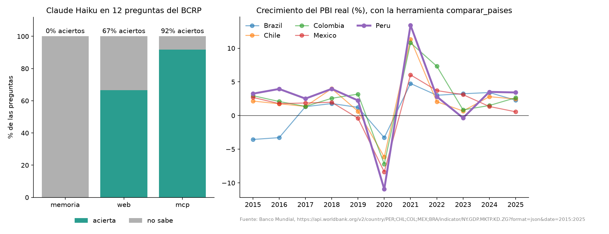
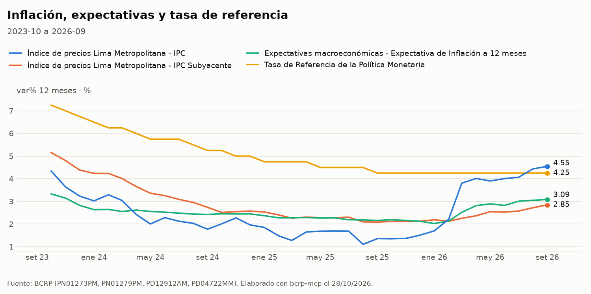

# bcrp-mcp · Un MCP con las series oficiales del BCRP

Servidor [MCP](https://modelcontextprotocol.io) hecho con [FastMCP 4](https://gofastmcp.com) que le da a Claude acceso
a las 17,167 series estadísticas del Banco Central de Reserva del Perú (BCRP) y, para el contexto regional, a los
indicadores del Banco Mundial. Las cuentas las hace Python, no el modelo: cada cifra sale de una llamada que se puede
repetir y viene con la URL de su fuente.

Tarea de la sesión 04 del curso [Data Science con Python](https://github.com/d2cml-ai/Data-Science-Python/tree/main/sessions/04-mcp-claude-code)
(el enunciado original está en [`ENUNCIADO.md`](ENUNCIADO.md)). Los resultados están en [`informe.md`](informe.md).



## Qué expone

| Tipo | Nombre | Qué hace |
|---|---|---|
| Herramienta | `buscar_series(texto, frecuencia, limite)` | Busca códigos de serie por palabras en el catálogo del BCRP. Primero muestra las series al día y al final las viejas o descontinuadas |
| Herramienta | `serie(codigo, desde, hasta)` | Descarga los datos de una serie (diaria, mensual, trimestral o anual) con la URL de la fuente. Avisa si la serie no llega al periodo pedido |
| Herramienta | `resumen(codigo, desde, hasta)` | Primero, último, cambio, variación %, promedio, máximo y mínimo, para que el modelo no calcule a mano |
| Herramienta | `transformar(codigo, operacion, desde, hasta, base)` | Variación interanual, respecto al periodo anterior o acumulada en el año, promedio anual, índice base 100 y valores reales (deflactados con el IPC de Lima) |
| Herramienta | `grafico(codigos, desde, hasta, transformacion, base, titulo, sombrear)` | Gráfico de hasta 5 series con estilo de publicación, guardado en `salidas/` |
| Herramienta | `exportar(codigos, desde, hasta, transformacion, base)` | Excel con los datos alineados por periodo y una hoja de metadatos, en `salidas/` |
| Herramienta | `comparar_paises(indicador, paises, desde, hasta)` | **Herramienta propia.** Compara al Perú con otros países en PBI, inflación, desempleo, PBI per cápita, exportaciones o deuda, con la API del Banco Mundial |
| Recurso | `bcrp://serie/{codigo}` | La ficha de una serie: nombre, categoría, frecuencia, inicio y última actualización |
| Prompt | `informe(tema)` | Pide un informe breve que cite el código y el periodo de cada cifra |
| Prompt | `coyuntura(periodo)` | Nota de coyuntura macro para economistas: inflación, tasa de referencia, PBI, tipo de cambio, términos de intercambio, reservas y crédito, con gráfico |

Ninguna de las dos APIs pide clave.

### Para economistas

- **Las transformaciones coinciden con las cifras del BCRP.** `transformar("PN38705PM", "var_interanual", ...)` da
  la misma inflación a 12 meses que publica el BCRP (PN01273PM), y `var_acumulada` da la misma variación acumulada
  (PN01272PM). Las pruebas lo verifican.
- **`real`** deflacta con el IPC de Lima (PN38705PM, dic. 2021 = 100) y expresa los valores a precios del periodo
  `base`. Si `base` es un año, usa el promedio de ese año. En series trimestrales o anuales, el deflactor es el
  promedio de los meses, y solo se usa si los meses están completos.
- **En series diarias**, como el tipo de cambio, las variaciones interanuales y acumuladas y los valores reales se
  calculan sobre el promedio de cada mes.
- **Avisos.** La herramienta avisa si se transforma una serie que ya es una tasa (por ejemplo, la variación
  interanual de una var%), si el último año de un promedio anual está incompleto, si se deflacta un monto en dólares
  con el IPC peruano o si la serie está descontinuada.
- **Gráficos.** Nunca usan dos ejes Y: las series con distinta unidad van en paneles separados y las tasas comparten
  panel. El último dato de cada serie se rotula al final de su línea. El pie cita los códigos y la fecha.



## Uso

Necesitas [`uv`](https://docs.astral.sh/uv/) y [Claude Code](https://claude.com/claude-code).

```bash
git clone https://github.com/LuisGuevaraVega/bcrp-mcp && cd bcrp-mcp
uv run pytest -q        # 20 passed; la primera vez baja el catálogo del BCRP (~7 MB) a datos/
claude                  # aprueba los servidores bcrp y fetch de .mcp.json
```

En Claude Code:

- *«¿Cuál fue la inflación de Lima a 12 meses en setiembre de 2026?»*
- *«¿Creció el Perú más que Chile y Colombia desde 2015?»* (usa `comparar_paises`)
- `@bcrp:bcrp://serie/PN01273PM ¿desde cuándo hay datos de esta serie?`
- *«Grafica la inflación, la subyacente y la tasa de referencia desde 2023»* (usa `grafico`)
- *«¿Cuánto creció el crédito en términos reales en el último año?»* (usa `transformar` con `real`)
- *«Pásame a Excel el tipo de cambio y las reservas de 2025 a hoy»* (usa `exportar`)
- `/mcp__bcrp__informe "precio de la plata"`: si el tema tiene varias palabras, ponlo entre comillas, porque Claude
  Code separa los argumentos por espacios.
- `/mcp__bcrp__coyuntura 2026-09`

Para usarlo en otro proyecto: `claude mcp add bcrp -- uv run --directory /ruta/a/bcrp-mcp server.py`.

## Archivos

| Archivo | Qué es |
|---|---|
| `server.py` | El servidor MCP |
| `test_server.py` | Las 8 pruebas del curso, sin cambios |
| `test_extras.py` | 12 pruebas de `transformar`, `grafico`, `exportar`, los avisos y el prompt de coyuntura |
| `ejemplos/` | Un gráfico de ejemplo hecho con `grafico` |
| `salidas/` | Donde `grafico` y `exportar` guardan sus archivos (no se sube) |
| `.mcp.json` | Los servidores `bcrp` y `fetch` para Claude Code |
| `preguntas.csv` | 12 preguntas con la cifra oficial (8 del curso y 4 propias) |
| `evaluar.py` | Hace cada pregunta a Claude (`claude -p`) sin herramientas, con búsqueda web y con el MCP, y califica |
| `resultados.csv`, `resultados_base.csv` | La corrida con web y la corrida base (memoria contra MCP) |
| `graficar.py` | Genera `grafico.png` |
| `informe.md` | El informe de la evaluación |

## Licencia

[MIT](LICENSE). Los datos son del [BCRP](https://estadisticas.bcrp.gob.pe) y del
[Banco Mundial](https://data.worldbank.org).
